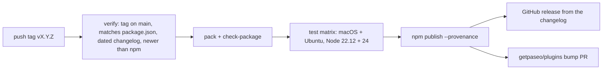

# Contributing

Mermaid is a client-only TypeScript plugin for Paseo 0.8.x through 0.12.x, including beta releases. It draws diagrams with React Native views, so it runs on desktop and mobile without a web view or SVG.

## Development setup

Use **Node.js 22.12.0 or newer** and npm. From the repository root:

```sh
npm ci --ignore-scripts --legacy-peer-deps
npm run check        # typecheck, then the full test suite
npm run preview      # regenerates docs/preview.svg from the real parser and layout
```

SDK development dependencies stay pinned to 0.8.0, so typechecking proves the plugin uses only the oldest supported API. Client code must not import `@getpaseo/client` or `@getpaseo/protocol` directly, even for types: they are development dependencies and are absent from an npm installation.

## Changelog and releases

Versions follow [semantic versioning](https://semver.org). A pull request with a user-visible change adds an entry under `## Unreleased` at the top of `CHANGELOG.md`, in the `Added`, `Changed`, `Fixed`, or `Removed` group. The release notes are that section, so write entries for people who run the plugin.

To cut a release from an up-to-date `main`:

```sh
node scripts/release.mjs prepare minor   # or patch, major, premajor, preminor, prepatch, prerelease (beta id), or 1.2.3-beta.1
npm run check
```

`prepare` dates the Unreleased section, sets the version in `package.json` and `package-lock.json`, and prints the commit, push, and tag commands. Pushing the `v` tag starts the [Release workflow](.github/workflows/release.yml):



Prereleases go to the `next` dist-tag and are marked as prereleases on GitHub. Versions only move forward: the workflow refuses a version below the newest one on npm, prereleases included.

If a run fails for a reason outside the tagged commit, such as npm settings or a flaky runner, fix it and run the workflow again from the same tag with `gh workflow run release.yml --ref vX.Y.Z`. A fix to the code needs a new version. A version already on npm is not published again; the run only completes the GitHub release.

The plugin directory on paseo.sh pins an npm version. A new npm release produces a bump pull request in [getpaseo/plugins](https://github.com/getpaseo/plugins) within about twelve hours, and the listing changes once a reviewer approves it. The listing text comes from `OVERVIEW.md` in the package; update it when setup or behavior changes, and keep install commands out of it: the directory rejects them, and so does `scripts/check-package.mjs`. Paseo Cafe expects the npm version to match `package.json` on `main`, so push the tag right after the release commit.

Publishing uses npm trusted publishing, so the repository stores no npm token. The package's trusted publisher on npmjs.com names repository `dutchakdev/paseo-plugin-mermaid`, workflow `release.yml`, and environment `npm`. Keep that environment limited to `v*` tags in the repository settings, since npm does not check which ref a run started from.

## Live validation

Run the checks, then `paseo plugin reload mermaid` and `paseo plugin ls` (expect `running`). Ask an agent for a flowchart and a sequence diagram and watch them while the message streams, not only after it completes; check the toolbar, pop out, a compact window, and both themes.
