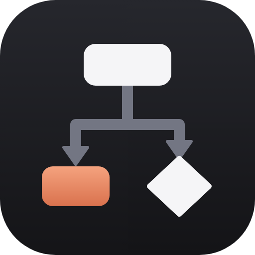
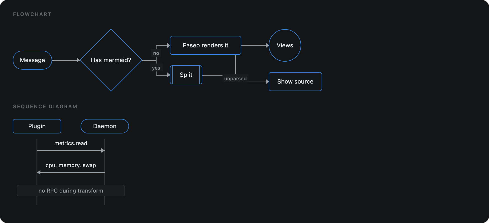
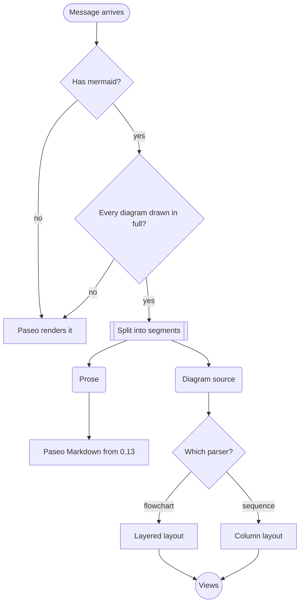

<p align="center"></p>

<h1 align="center">paseo-plugin-mermaid</h1>

<p align="center">
  Mermaid diagrams drawn inside the <a href="https://paseo.sh">Paseo</a> chat timeline.<br>
  When an agent replies with a <code>```mermaid</code> block, you get the drawing instead of the source.
</p>

<p align="center">
  <a href="https://github.com/dutchakdev/paseo-plugin-mermaid/actions/workflows/ci.yml"></a>
  <a href="https://www.npmjs.com/package/paseo-plugin-mermaid"></a>
  
  
  
</p>

<p align="center">
  
</p>

<p align="center"><sub>Generated by <code>npm run preview</code>: the diagram above comes from the plugin&apos;s own parser and layout, so the picture cannot drift from the code.</sub></p>

Listed in the [Paseo plugin directory](https://paseo.sh/plugins/dutchakdev/mermaid).

- **Inline, from the first streamed line.** The diagram is drawn in the message at the
  width of the chat while the agent is still writing it.
- **Flowcharts and sequence diagrams**, with the usual node shapes, edge styles and labels.
- **A toolbar on every diagram:** zoom, fit to view, pop out, and the source on demand.
- **`.mmd` files in the file tab** on Paseo 0.13 and newer, redrawn when the file changes.
- **Nothing leaves the app.** The plugin has no server half, no settings and no network
  access; it reads the message text it is given and draws it with React Native views.

Paseo draws Mermaid itself too, in an iframe inside a zoomable box with a
fullscreen viewer, and it draws every diagram type. This plugin draws flowcharts
and sequence diagrams inline instead: readable at the width of the message, from
the first streamed line, with the same controls above it for the times the fitted
drawing is not enough: zoom, fit to view, pop out, and the source on demand. A
diagram it cannot draw in full stays with Paseo's renderer.

## Install

Plugins must be enabled daemon-wide first, under **Settings → Plugins → Enable
plugins**. Then pick the source that matches your Paseo:

| Paseo | Source | Command |
| ----- | ------ | ------- |
| 0.11 and newer | [Plugin directory](https://paseo.sh/plugins/dutchakdev/mermaid), the reviewed version | `paseo plugin add dutchakdev/mermaid` |
| 0.11 and newer | npm, the newest release before the directory approves it | `paseo plugin install npm:paseo-plugin-mermaid` |
| 0.8 to 0.10, 0.11.0 betas | GitHub, release 0.2.4, the last one for these versions | `paseo plugin add dutchakdev/paseo-plugin-mermaid --ref v0.2.4` |

`paseo plugin ls` should then show `mermaid` as `running`, and `paseo plugin update mermaid`
pulls later releases from the same source. From Paseo 0.11 a bare `owner/name` names a
directory entry, so a GitHub source there needs the `git:` prefix:
`git:dutchakdev/paseo-plugin-mermaid`.

The plugin supports **Paseo 0.11.x through 0.14.x, including betas**, on both
sides: the daemon compiles it, and the app checks its declared version range.
It has no server entry, so it starts no daemon process.

The manifest asks for `>=0.11.0` because it declares the icon shown in the plugin
directory, and Paseo 0.8 to 0.10 refuse a manifest with a field they do not know.
Paseo also checks a prerelease's stable version core, so `0.14.0-beta.1` satisfies
this range. The 0.11.0 betas pass that check but predate the `icon` field, so they
refuse the manifest as well and need the release named in the install table; see
[version requirements](https://paseo.sh/docs/plugins/reference#requirements).
The development SDK is pinned to 0.13.2 for its types; Paseo supplies the runtime
modules. Paseo's Markdown component and file panels arrived in 0.13, so the plugin
checks for them at runtime and works without them on 0.11 and 0.12.

To work on it locally instead:

```sh
git clone https://github.com/dutchakdev/paseo-plugin-mermaid.git
cd paseo-plugin-mermaid
npm install
npm run typecheck && npm test
paseo plugin install "$PWD"
```

## What it draws

| Diagram | Supported |
| ------- | --------- |
| `flowchart` / `graph` | `TD`, `TB`, `BT`, `LR`, `RL` |
| Node shapes | `[rect]`, `(round)`, `([stadium])`, `[[subroutine]]`, `{diamond}`, `((circle))`, `>asymmetric]` |
| Edges | `-->`, `---`, `-.->`,  `-.-`, `==>`, `===` |
| Edge labels | `-->|both|` and `-- forms -->` |
| `sequenceDiagram` | participants, actors, notes, messages to oneself |
| Message arrows | `->`, `->>`, `-->`, `-->>`, `-x`, `--x`, `-)`, `--)` |

Everything else is left to Paseo, which renders it with Mermaid: other diagram
types, subgraphs, other node shapes (cylinders, hexagons, parallelograms, double
circles), Markdown string labels, `style` and `classDef` lines, `&` and `;` that
join several nodes or statements on one line, sequence blocks such as `loop` and
`alt`, `%%{init}%%` directives, and front matter. The plugin takes a message only
when its parsers read every line of every diagram in it.

When the plugin draws a message, the text around the diagram goes through Paseo's
own Markdown on Paseo 0.13 and newer, so it looks like the rest of the chat; a
reference link keeps working when its definition sits on the other side of the
diagram. On
0.11 and 0.12 it goes through the plugin's renderer, which covers headings, lists,
emphasis and code.

## Controls

Every drawing carries a toolbar: `Zoom out · 100% · Zoom in · Fit to view · Pop out`
on the left and `Show code` on the right. The zoom model is the one Paseo's own
diagram box uses, so a reader who knows one knows the other.

| Control | What it does |
| ------- | ------------ |
| **Zoom in / out** | Steps by ×1.25 and ÷1.25 between 25% and 400%. A button goes quiet at its limit. |
| **100%** | The zoom relative to the fitted drawing. Fitted means scaled to the width of the row, grown a little when small, and never shrunk past the point where labels stop being readable. |
| **Fit to view** | In the row: show the whole drawing across the row, even below the readability floor, for the wide ones that would otherwise scroll sideways. It never grows a drawing past 100%. In the pop-out: fit both axes of the window. Quiet once it is there. |
| **Pop out** | Opens the drawing in a host modal, fitted to the window on both axes, with the same toolbar. Zoomed past the window, it scrolls on both axes. |
| **Show code** | Swaps the drawing for its Mermaid source and quiets the zoom controls until you switch back. |

Zooming in the row makes the row taller and, past its width, scrolls it
sideways; the transcript scrolls vertically as it always does, so nothing is
clipped. On phones and narrow windows the button labels drop and the icons and
the percent stay.

## Mermaid files

On Paseo 0.13 and newer, `.mmd` and `.mermaid` files can open in the file tab as
**Mermaid diagram**. Paseo offers it beside its Source editor the first time such a
file opens, and **Open with…** in the tab menu switches between them. The drawing
has the same toolbar as in the chat and redraws when the file changes on disk, so
a diagram an agent is editing updates in place. A diagram the plugin does not draw
in full is rendered in the same tab by Paseo's Markdown, which uses Mermaid.

## How it works



These constraints shaped this plugin.

**Mermaid itself cannot run here.** A Paseo client bundle may import only the modules the
app provides: `react`, `react-native`, `@tanstack/react-query`, `zod` and the
`@getpaseo/plugin` entries. There is no
SVG, no canvas and no webview, and Mermaid needs a DOM. So the parser, the layout
and the drawing are all written from scratch. Every line you see is a positioned
`View`: node boxes, edge segments 1.5px thick, and arrowheads made from a View
with three transparent borders.

**A transformer replaces the whole timeline entry.** Once a message contains a
diagram, the plugin owns the message. It is split into prose and diagram
segments, and each becomes its own item, so the text around the diagram keeps its
place. From Paseo 0.13 that prose goes through Paseo's own Markdown component;
before it, through a small renderer covering headings, lists, emphasis and code.
Messages without a diagram are left alone entirely.

**A diagram is drawn in full or not at all.** Paseo's renderer runs Mermaid and
draws everything, so a drawing with lines missing would be worse than leaving the
message to it. The parsers report every line they skip, and one skipped line in
any diagram leaves the whole message to Paseo (`shared/drawable.ts`). That is
decided from what the parsers read, not from the first word of the source, so the
parsers refuse what they would draw wrong rather than accept it loosely: a label
with a stray square bracket, a label wrapped whole in brackets that names another
shape, a directive.

**Items store the source, not a parsed graph.** Parsing happens at render time.
The stored data stays small, and a later fix to the parser improves diagrams that
were sent months ago.

**The fence is claimed while it is still open.** Paseo runs transformers on every
streaming update, and it renders `mermaid` fences itself as soon as one opens. A
transformer that waited for the closing ``` would leave the host drawing the
diagram for the whole stream and then swap renderers at the last line. An
unfinished block is therefore taken over at once and drawn from whatever has
parsed so far. While the message streams and the fence is open, the last line
counts only once its newline has arrived: until then it may be half typed.
Finished lines never change, so a diagram that does need Paseo, say one that opens
a subgraph, is handed over once, at the first line that shows it. A finished
message is judged on every line, even when its fence never closed.

**The drawing is fitted to the row.** A diagram's natural size is whatever its
labels happened to add up to, which is no basis for how big it should appear. The
row is measured, the drawing is scaled to fit, small diagrams are grown a little
so they do not look lost, and shrinking stops at the point where labels would
stop being readable. Only past that does it scroll sideways. The toolbar's zoom
multiplies that fit, which is why 100% is the fit itself and not the natural size.

## Development

```sh
npm run check            # typecheck, then the tests
npm run preview          # regenerates docs/preview.svg from the parser and layout
./scripts/preview-png.sh # renders it to docs/preview.png for the plugin directory
paseo plugin reload mermaid
```

The parsers, the layout, the zoom model and the transform are pure functions
with no runtime dependencies, and that is where the tests are: bracket shapes,
operator precedence (`-.->` must never read as `-.-` plus a stray `>`), cycles in
a flowchart, node overlap, arrow direction, zoom steps that land back on 100%,
which toolbar controls are live, which diagrams go to Paseo (checked on diagrams
from this owner's own docs, in `tests/fixtures/`), and the JSON round trip Paseo
performs on item data before rendering. The Views themselves are checked by
`npm run typecheck` and by reloading the plugin. `npm run check:bundle` compiles
the client entry with the installed daemon's compiler and loads it into a stand-in
0.11 app and a 0.13 app; it needs the `paseo` CLI, so it runs locally, not in CI.

| File | Role |
| ---- | ---- |
| `shared/segment.ts` | splits a message into prose and diagram blocks |
| `shared/flowchart.ts` | flowchart parser |
| `shared/sequence.ts` | sequence diagram parser |
| `shared/layout.ts` | layered layout, orthogonal edge routing, column layout |
| `shared/markdown.ts` | the Markdown subset used for prose |
| `shared/zoom.ts` | zoom steps, fit to view, and which controls are live |
| `shared/drawable.ts` | whether the plugin draws a diagram in full, or leaves the message to Paseo |
| `shared/transform.ts` | the timeline transform itself |
| `shared/file-view.ts` | what the file panel shows for a `.mmd` file |
| `client/diagram.tsx` | drawing, in Views, at natural size |
| `client/viewer.tsx` | fitting, zoom and the source toggle, in the row and in the pop-out |
| `client/toolbar.tsx` | the toolbar |
| `client/markdown.tsx` | prose rendering before Paseo 0.13 |
| `client/item.tsx` | the two timeline renderers |
| `client/file-panel.tsx` | the `.mmd` file panel |
| `client/compat.ts` | runtime checks for what apps before 0.13 lack |
| `index.client.tsx` | registers the transformers, renderers and file panel; the only entry |

Releases are cut from tags by GitHub Actions; see [CONTRIBUTING.md](CONTRIBUTING.md)
for the flow and [CHANGELOG.md](CHANGELOG.md) for what changed.

## License

MIT
